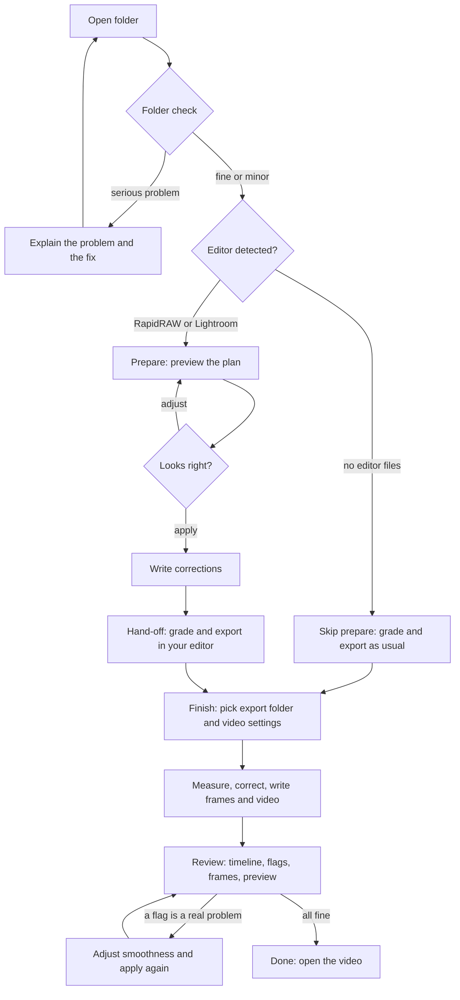
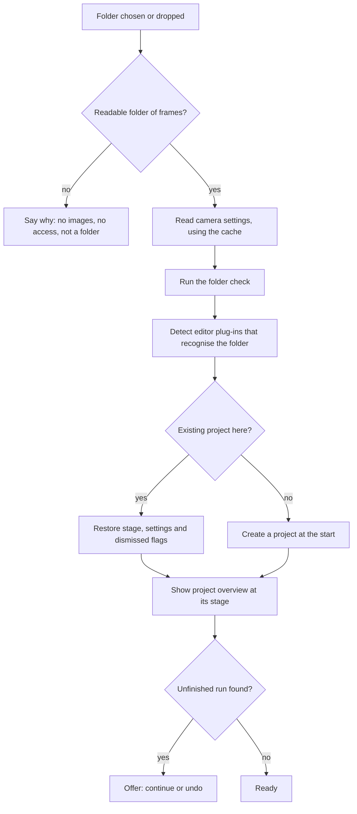
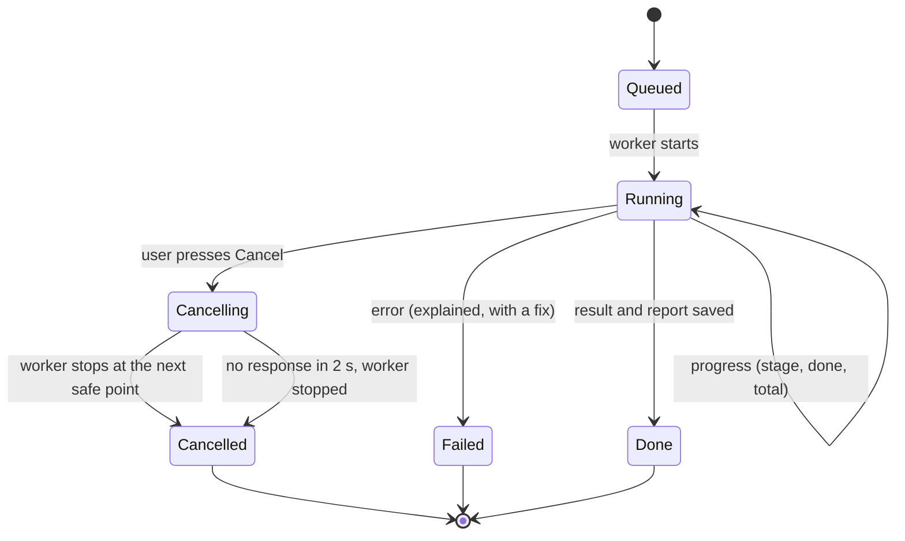
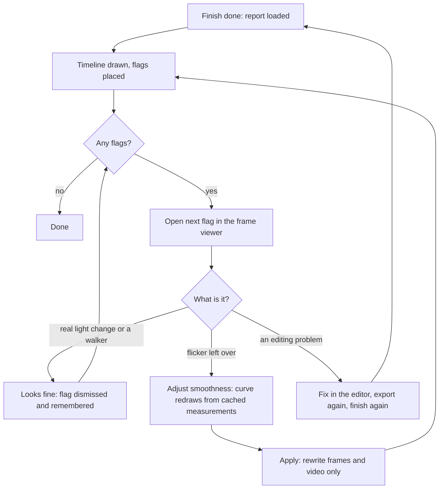
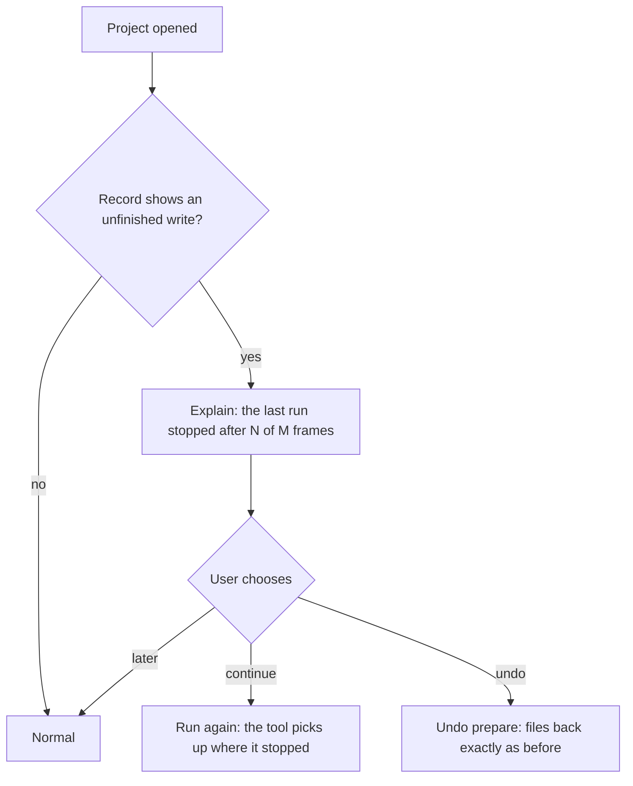
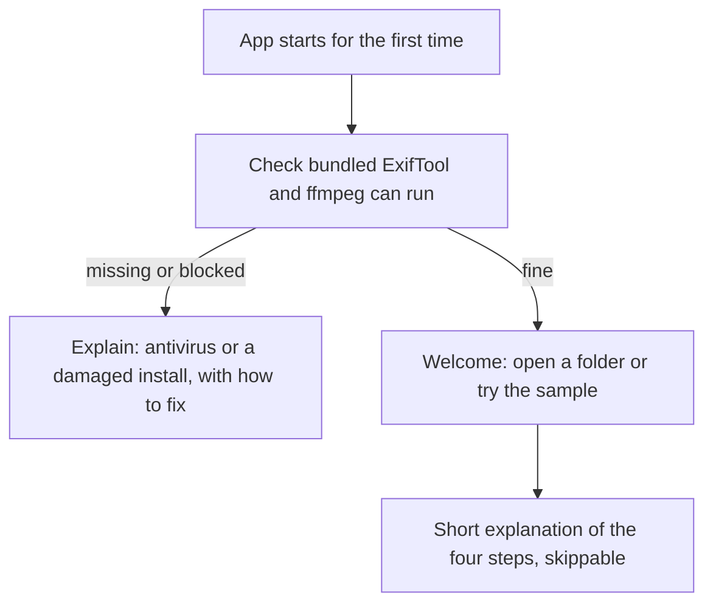
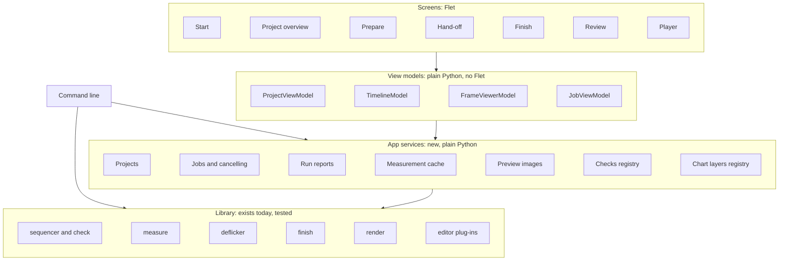
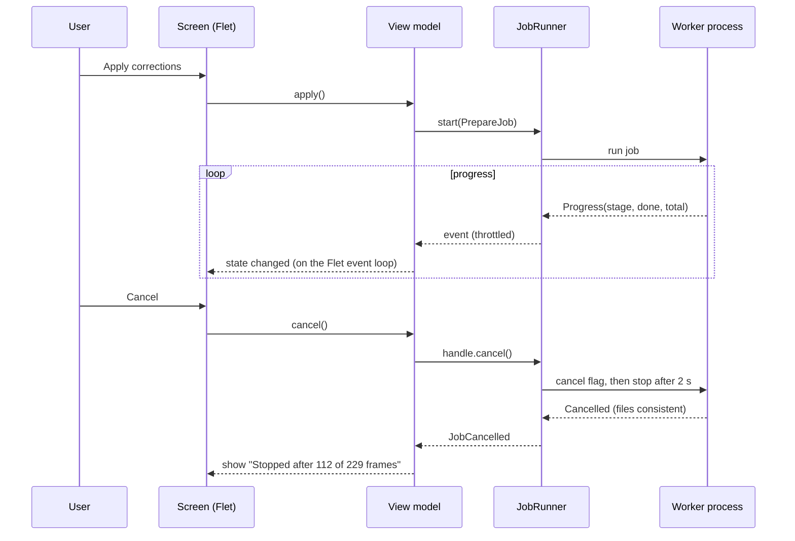

# harbium-timelapse app: design and architecture plan

Status: proposal for review. October 2026.

This is the plan for turning harbium-timelapse into an app that anyone can use, without Python or a command line. It covers who the app is for, what it needs to do, how it should look and behave, how it's put together so later changes are easy, and what could go wrong. Nothing here has been built yet; the first phase is a set of small experiments that prove the risky parts before any real building starts.

## Contents

1. Summary and the decisions I need from you
2. Context and constraints
3. Who it's for (personas)
4. What they need to do (user stories)
5. Priorities (MoSCoW)
6. Functional requirements
7. Quality requirements
8. Design principles and usability heuristics
9. Visual direction
10. Process flows
11. Wireframes
12. Architecture
13. Security
14. Risks of building on Flet
15. Performance and optimisation
16. How future changes slot in
17. Testing and validation
18. Roadmap
19. Things that are easy to miss
20. Decision records

---

## 1. Summary and the decisions I need from you

The app is a thin layer over the library that already exists. Every piece of image science stays in the library, where it's tested; the app only collects choices, starts work, shows progress and draws results. Between the two sits a small new "app services" layer that handles the things a GUI needs and a command line doesn't: background jobs that can be cancelled, a report file describing each run, caches that make re-runs instant, preview images, and the spike-based check that flags frames worth a look.

The app is built around one guided flow (pick a folder, prepare, grade in your editor, finish, review) with the review screen as its centrepiece: a timeline of the light across the sequence, the smoothing curve drawn over it, flagged frames marked on it, and the frames themselves one click away.

Flet looks like a good fit, but it reached 1.0 only in September 2026, so a few things need proving before committing: that a packaged Flet app can bundle our compiled libraries and helper programs, that worker processes behave in a packaged app (supported since Flet 0.86, but to be confirmed with our code), and that it can show frames quickly enough for scrubbing and preview. Those are the first experiments (section 18). If any of them fails badly, the design still holds: only the screen layer would change, to Qt.

Decisions, as agreed on 20 October 2026:

1. **No code signing for now.** The first-run warning is handled with clear instructions and published checksums (section 13, "Releasing unsigned").
2. **ffmpeg is bundled inside the app,** invisible to the user. Route: the GPL build with x264 as a separate program, unless experiment S7 shows Windows' own H.264 encoder is as good (section 13, "Bundling ffmpeg").
3. **Windows is the supported platform.** Mac and Linux builds are published as experimental until people in the community test them.
4. **No automatic updates.** An optional "Check for a new version" opens the GitHub release page.
5. **No telemetry.** The app sends nothing anywhere unless the user asks.
6. **A sample sequence** shot by James, released under CC BY, ships with the app and doubles as a public benchmark. Due in the coming weeks.

---

## 2. Context and constraints

What exists today: a tested Python library (about 5,300 lines, 237 tests) with two commands. `timelapse prepare` writes white balance and deflicker corrections into an editor's edit files (RapidRAW fully, Lightroom experimentally). `timelapse finish` measures exported frames, smooths what's left, and writes corrected frames and a video. Safety is already built in: originals untouched, edit files backed up, records kept in step with every write, one run per folder, atomic writes.

Constraints that shape the plan:

- **One developer, plus me.** The design has to stay small enough to maintain. Fewer moving parts beats cleverness.
- **Windows first.** Windows is the supported platform. Mac and Linux builds are published as experimental until people in the community test them, so nothing in the design may rule them out.
- **Offline.** Photographers work on laptops in the field and on locked-down machines. The app must do everything without an internet connection.
- **Users already run a RAW editor.** Almost nobody makes a timelapse without one, so the editor's own hardware needs set a realistic floor: a machine that runs Lightroom Classic or RapidRAW comfortably should run this app comfortably. The app must never be the thing that makes a machine fall short.
- **Big data on slow drives.** A typical sequence is 200 to 2,000 RAW files of 20 to 60 MB each, often on an external drive. Reading them is the slowest part of everything.
- **The library stays the source of truth.** The command line keeps working and keeps full feature parity; anything the app can do, a script can do.
- **The editor stays in charge of the look.** The app never tries to replace the photographer's editor; it hands over and takes back.

---

## 3. Who it's for

Four personas, built from the people this tool has met so far and the people it's aimed at. They're deliberately different, because a design that suits only one of them would fail the others.

### James, the working pro

Event and conference photographer. Shoots timelapses for clients a few times a year, alongside thousands of stills. Edits in RapidRAW and knows Lightroom. Comfortable with numbers and wants to see them; dislikes tools that hide what they did. Works on Windows, often from an external drive, often under deadline.

What he needs: speed, trustworthy results, and evidence. He wants to see the curve, know which frames were changed and by how much, and step in only where it matters.

What would make him give up: anything that silently changes his edits, or makes him wait without saying why.

### Priya, the landscape hobbyist

Shoots sunsets and the occasional holy-grail day-to-night sequence at weekends. Edits in Lightroom; has looked at LRTimelapse but found it expensive and complicated. Confident editing photos, never opened a terminal. Uses a MacBook.

What she needs: clear guidance through the Lightroom steps (save metadata, read it back), and confidence nothing will be lost.

What would make her give up: jargon, a command line, or an error message she can't act on.

### Tom, the beginner

Bought his first mirrorless camera this year. Shot 300 frames of the city at dusk with everything on automatic: auto white balance, auto ISO. The result flickers and changes colour. He doesn't really edit RAW files yet.

What he needs: one obvious path from a folder of photos to a smooth video, sensible defaults, and words he understands. He doesn't know what a "stop" is.

What would make him give up: being asked to make decisions he doesn't understand, or a scary warning when he installs it.

### Sam, the contributor

A developer who edits in darktable and wants to add support for it. Reads code, runs tests, uses the command line.

What Sam needs: a clear place to plug in an editor so it appears in the app automatically, and documentation.

What would make Sam give up: having to edit app code to add an editor.

### Not designed for, yet

Drone and handheld hyperlapse makers. The camera moves between frames, which the measurement doesn't support yet. The app should recognise this case and say so plainly, rather than produce a bad result quietly.

---

## 4. What they need to do (user stories)

Written as "As a ..., I want ..., so that ...", grouped by stage. Each has acceptance criteria that tests and usability sessions can check. IDs are referenced from the requirements.

### Getting started

**US-1** As Tom, I want to install the app with a normal installer and no other downloads, so that I don't have to set anything up.
- Installing needs no Python, ExifTool or ffmpeg installed separately.
- The app opens with an empty state that tells me what to do next.

**US-2** As anyone, I want to open a sequence by dragging a folder onto the window or choosing it, so that starting is obvious.
- Both drag-and-drop and a "Choose folder" button work.
- Within a few seconds I see the frame count, camera and detected editor, or a clear reason why the folder can't be used.

**US-3** As Priya, I want problems with my folder explained in plain words with what to do about them, so that I'm not stuck.
- Each problem says what's wrong, which frames, how serious it is, and the fix.
- Serious problems block the next step with the reason shown; minor ones don't.

**US-4** As Tom, I want to try the app on a built-in sample sequence, so that I can learn it before using my own photos.

### Preparing

**US-5** As James, I want to see what `prepare` will change before it changes anything, so that I can trust it.
- A preview shows the measured light, the smoothing curve and the planned correction for every frame.
- Nothing is written until I press Apply.

**US-6** As anyone, I want long jobs to show progress, time remaining and a Cancel button that works, so that I'm never stuck waiting.
- Progress updates at least twice a second; Cancel stops within two seconds and leaves every file consistent.

**US-7** As Priya, I want to be told exactly what to do in Lightroom before and after `prepare`, so that I don't lose edits.
- Before: a checklist including "Save Metadata to Files", which I tick off.
- After: the "Read Metadata from Files" step, with the frames to select.

**US-8** As anyone, I want to undo everything the app added to my edit files, so that trying it is risk-free.
- One button, with a confirmation that names what will be undone; files return to their previous state exactly.

### Grading

**US-9** As James, I want to switch to my editor, grade and export, then come back to where I left off, so that the app fits my workflow.
- The project remembers its stage; reopening it lands on the next step.
- If the editor is still open when I try to change files, I'm told to close it.

### Finishing

**US-10** As Tom, I want to choose 1080p or 4K and a frame rate from a short list, so that I get a video without knowing ffmpeg.

**US-11** As James, I want `finish` to pick up my export folder automatically when it can, so that I don't navigate my drive twice.

### Reviewing and refining

**US-12** As James, I want a timeline of brightness and colour across the sequence, with the smoothing curve drawn over it, so that I can see what was done and why.

**US-13** As James, I want frames that might need a look marked on the timeline, so that I can check the likeliest problems first instead of watching the whole film repeatedly.
- Flags only frames that break away from both neighbours. Real light ramps (sunrise, nightfall) are not flagged. The first and last frames are marked "can't judge" rather than flagged.

**US-14** As James, I want to click a flagged frame and see it beside its neighbours, before and after, so that I can judge it in seconds.
- Shows the previous, current and next frames; a before/after toggle; a "blink" comparison; a "looks fine" button that dismisses the flag and remembers it.

**US-15** As James, I want to adjust smoothness and see the effect on the curve straight away, so that refinement takes seconds, not minutes.
- Moving the slider redraws the corrected curve in under a fifth of a second; files are only written when I press Apply.

**US-16** As anyone, I want to play a preview of the timelapse inside the app, before and after, so that I can judge it as a film.

### Safety, help and contributing

**US-17** As anyone, I want the app to recover cleanly if it crashes or the drive disconnects mid-run, so that I never lose work.
- On reopening, the project shows what was finished and offers to continue or undo.

**US-18** As anyone, I want to report a problem with one click, so that the bug can be fixed.
- Creates a diagnostics file (versions, settings, the run's report, the log) with no photos and no personal data, and opens the GitHub issue page.

**US-19** As Sam, I want an editor plug-in I write to appear in the app automatically, with its own instructions, so that I don't touch app code.

**US-20** As a hyperlapse maker, I want to be told clearly that a moving camera isn't supported yet, so that I don't trust a bad result.

---

## 5. Priorities (MoSCoW)

For the first public release of the app.

| Priority | What |
|---|---|
| **Must** | Installer with ExifTool and ffmpeg bundled (US-1). Open a folder by drag or button (US-2). Plain-English folder check (US-3). Prepare with preview-before-apply, progress and cancel (US-5, US-6). Undo (US-8). Editor-specific hand-off steps for RapidRAW and Lightroom (US-7, US-9). Finish with simple video settings (US-10). Timeline of the light with the smoothing curve (US-12). Spike-based flags on the timeline (US-13). Crash and disconnect recovery (US-17). Works fully offline, sends nothing. |
| **Should** | Frame viewer with neighbours, before/after and blink (US-14). Smoothness slider with instant redraw (US-15). Remember projects and their stage (US-9). Auto-find the export folder (US-11). Diagnostics bundle (US-18). Detect a moving camera and warn (US-20). Keyboard shortcuts for the review screen. |
| **Could** | In-app film preview (US-16). Built-in sample sequence (US-4). Optional "check for a new version". Keyframe suggestions shown on the timeline. Experimental Mac and Linux builds. Light theme. |
| **Won't (this release)** | Hyperlapse support. Editing the look inside the app. Batch processing of several sequences at once. Mobile or web versions. Automatic updates. Any account, login or cloud feature. |

---

## 6. Functional requirements

Numbered so tests and issues can refer to them. "The app" means the GUI; anything marked (library) belongs in the library so the command line gets it too.

### Projects and folders

| ID | Requirement | Stories |
|---|---|---|
| FR-1 | The app opens a folder chosen by dialog or dropped on the window, and lists recent projects. | US-2 |
| FR-2 | Opening a folder reads frame count, camera, settings and editor, using the settings cache so a second open is near-instant. | US-2 |
| FR-3 | The folder check runs automatically, and each problem is shown with its seriousness, frames affected, explanation and fix. Serious problems block the steps they affect. (library: problems gain a `fix` sentence) | US-3 |
| FR-4 | A project remembers its stage (opened, prepared, exported, finished), its settings and dismissed flags, stored in the folder's existing `.timelapse-core` area. | US-9 |
| FR-5 | When the camera moves between frames (measured by aligning frames), the check says hyperlapses aren't supported yet. (library) | US-20 |

### Prepare

| ID | Requirement | Stories |
|---|---|---|
| FR-6 | "Preview" runs the measuring and planning without writing, and shows the result on the timeline. | US-5 |
| FR-7 | "Apply" writes the planned corrections through the editor plug-in, with progress and Cancel. | US-5, US-6 |
| FR-8 | The app refuses to write while the editor is open, and says which editor to close. | US-9 |
| FR-9 | Editor plug-ins can describe their hand-off steps (before and after), which the app shows as a checklist. (library: optional method on the editor contract) | US-7, US-19 |
| FR-10 | "Undo prepare" reverses everything prepare added, after a confirmation. | US-8 |

### Finish

| ID | Requirement | Stories |
|---|---|---|
| FR-11 | The app suggests the most likely export folder (newest folder of frames near the RAW folder) and lets the user change it. | US-11 |
| FR-12 | Video settings come from a short list: resolution (original, 4K, 1080p), frame rate (24, 25, 30), and optionally corrected frames as files. | US-10 |
| FR-13 | Finish writes a report file next to its output describing every frame's measurement, target and correction, plus the flags. (library) | US-12, US-13 |

### Review and refine

| ID | Requirement | Stories |
|---|---|---|
| FR-14 | The timeline shows the measured light, the smoothing curve and the corrected result for brightness, with colour balance on a second track, from the report. | US-12 |
| FR-15 | The spike check flags frames that break away from both neighbours by more than a visible amount, measured as the distance from the midpoint of the two neighbouring frames: a ramp passes through that midpoint however steep it is, a spike doesn't. (Found in the mockup: the simpler "jumps one way, then back" rule missed a real spike on the steep part of nightfall.) The outermost frames are "can't judge". (library) | US-13 |
| FR-16 | Clicking a frame opens the frame viewer: previous, current and next frame, before/after toggle, blink comparison, "looks fine". | US-14 |
| FR-17 | The smoothness setting re-plans from cached measurements without re-reading frames, and redraws the curve. | US-15 |
| FR-18 | "Apply changes" re-runs only the writing step with the new plan. | US-15 |
| FR-19 | The preview player plays the sequence from small preview images, before or after, at the chosen frame rate. | US-16 |

### Safety, help, diagnostics

| ID | Requirement | Stories |
|---|---|---|
| FR-20 | Every job can be cancelled; after cancel, crash or disconnect, the project reopens consistent and offers to continue or undo. | US-6, US-17 |
| FR-21 | A diagnostics file can be saved with versions, settings, the run report and the log, and with paths shortened to folder names and no image data. | US-18 |
| FR-22 | Editor plug-ins installed in the same Python environment appear in the app automatically. | US-19 |
| FR-23 | The about screen lists versions and the licences of everything bundled. | |
| FR-24 | The app chooses preview size, playback frame rate and the number of workers to suit the machine (QR-17), shows what it chose in settings, and lets the user change it. | |

---

## 7. Quality requirements

Each has a number so it can be tested, against two reference machines and a 229-frame Canon R6 sequence unless stated.

| Reference machine | What it is | Why |
|---|---|---|
| **Typical** | 8-core laptop or desktop, 16 GB of memory, SSD for the app, photos on an external USB 3 drive | What most of our users will have |
| **Minimum** | 4-core processor from about 2017 onwards, 8 GB of memory, integrated graphics with DirectX 12, 1080p screen, Windows 10 22H2, photos on an external USB hard drive (spinning) | At or below Lightroom Classic's own minimum (Windows 10 22H2 or 11, 8 GB of memory, a DirectX 12 GPU with 2 GB). If someone's machine runs their editor, it runs this. |

The targets below are for the typical machine; QR-16 sets the targets for the minimum machine.

| ID | Quality | Target |
|---|---|---|
| QR-1 | Start-up | The window appears in under 3 seconds. |
| QR-2 | Responsiveness | Any click or key gets a visible response within 100 ms; the window never freezes during a job. |
| QR-3 | Opening a project | Under 2 seconds when the settings are cached. First time, limited by the drive, with progress shown from the first second. |
| QR-4 | Re-planning | Changing smoothness redraws the curve in under 150 ms for 2,000 frames. |
| QR-5 | Cancel | Cancel takes effect within 2 seconds; files are consistent afterwards (provable: the existing interruption tests, run through the app layer). |
| QR-6 | Scrubbing and preview | Stepping through frames in the viewer shows each frame within 100 ms; preview playback holds 24 frames a second at 960 pixels wide. |
| QR-7 | Memory | Under 1.5 GB for a 2,000-frame sequence, whatever the frame size. |
| QR-8 | Reliability | No lost or half-written files after a crash, power cut or unplugged drive at any moment (atomic writes, records kept in step, verified by tests that kill the job process). |
| QR-9 | Privacy | No network traffic at all unless the user asks to check for updates or report a problem. |
| QR-10 | Accessibility | Everything works from the keyboard; text contrast at least 4.5:1; controls have labels for screen readers; nothing is shown by colour alone; respects the system's reduced-motion setting. |
| QR-11 | Learnability | A first-time user (Tom) gets from install to a finished video of the sample sequence in under 10 minutes without help, in usability testing. |
| QR-12 | Satisfaction | System Usability Scale score of 75 or more across five test users. |
| QR-13 | Install size | Installer under 400 MB. |
| QR-14 | Maintainability | No image maths in the GUI code; the GUI layer is under a quarter of the codebase; app services and view logic are testable without starting a window. |
| QR-15 | Portability | Nothing in the app services or view logic is Windows-specific; platform differences live in one module. |
| QR-16 | Minimum machine | Everything works, nothing freezes, and: the window appears in under 6 seconds; a cached project opens in under 4 seconds; re-planning redraws in under 300 ms; the frame viewer shows each frame within 250 ms; preview playback is smooth at 24 frames a second with smaller previews (640 px), or at a lower frame rate with a note saying so; memory stays under 1 GB for 2,000 frames. Measuring and finishing may take longer; they're limited by the processor and the drive, exactly as in the user's editor. |
| QR-17 | Adapting to the machine | The app adapts by itself (preview size, playback frame rate, number of workers) based on the machine's cores and memory and on timing its first few previews, so nobody has to find a setting. Each choice can be overridden in settings. |

---

## 8. Design principles and usability heuristics

### Five principles specific to this app

1. **The photographs are sacred.** Nothing the app does can damage an original or lose an edit. Every change is backed up, recorded and reversible, and the app says so where it matters, so people feel safe trying things.
2. **Show the light.** The core idea, light changing slowly while flicker jumps, is visual. The timeline makes it visible, and every number the app shows connects to something on screen.
3. **Honest numbers.** Results are measured, never claimed. When the app isn't sure (the ends of a sequence, a moving camera, a mostly black frame), it says so instead of guessing.
4. **The editor is the artist's.** The app prepares and finishes; the look belongs to the photographer and their editor. The app hands over clearly and takes back cleanly.
5. **One obvious next step.** At every point there's one primary action, and the screen makes it plain. Everything else is secondary and stays quiet.

### Nielsen's ten heuristics, applied

| Heuristic | What it means here |
|---|---|
| Visibility of system status | A persistent stage bar (Folder, Prepare, Grade, Finish, Review) shows where the project is. Jobs show stage, count, time remaining and Cancel. |
| Match with the real world | Photographers' words: frames, exposure, white balance, export, stops. "Stops" are explained once, on hover, for Tom. No "pipeline", "plan", "ledger" or "LOWESS" in the interface. |
| User control and freedom | Preview before apply; Undo prepare; Cancel always; "looks fine" can be undone; nothing irreversible without a confirmation that names what will happen. |
| Consistency and standards | An action keeps the same name through the flow: the button "Apply corrections" produces "Corrections applied". Platform-standard dialogs and shortcuts. |
| Error prevention | Serious folder problems block the affected step; the editor-open check runs before writing; disk space is checked before finishing; the export folder can't be the RAW folder. |
| Recognition rather than recall | The hand-off checklist shows the editor steps when they're needed, so nobody has to remember the Lightroom metadata dance. Recent projects on the start screen. |
| Flexibility and efficiency | Keyboard shortcuts in review (arrow keys to step through frames, F to jump to the next flag, B to blink, Space to play). Power users can see raw numbers in a details panel; others never need to. |
| Aesthetic and minimalist design | Only what the current step needs. Details are one click away, not on screen by default. |
| Help users recover from errors | Every error says what happened, what it affects and what to do, in the interface's voice, with a button for the fix where possible ("Close RapidRAW, then try again" with a Retry button). |
| Help and documentation | Each step has a one-paragraph explanation and a link to the full guide. The diagnostics bundle makes asking for help easy. |

### Domain heuristics worth adding

- **Neutral surroundings for colour judgement.** Anything around a photograph should be neutral grey, without a colour tint, because tinted surroundings shift how colour is perceived. This rules out tinted dark themes and coloured panels next to frames.
- **Never show a frame altered without saying so.** Previews are labelled "before" or "after" at all times.
- **Respect the photographer's time on big jobs.** Anything over about 10 seconds runs in the background, can be cancelled, and announces itself when done (a system notification if the window isn't in front).

---

## 9. Visual direction

The subject is light measured over time, and the people using it judge colour for a living. That gives the visual direction two firm rules and one place to be distinctive.

**Rule 1: neutral grey around images.** The interface surrounding frames is true neutral grey with no colour tint, in a dark and a light variant. This isn't a style choice; it's what colour-critical viewing requires.

**Rule 2: colour means something.** Colour appears only where it carries information. The colour-balance track uses the axis it measures: amber for warmer, blue for cooler. Brightness is drawn in a near-white line. Flags use one accent colour reserved for "look here". No decorative colour anywhere else.

**The distinctive element: the timeline.** It's the one memorable thing in the app, drawn like a light meter's record over time: measured light as a fine line, the smoothing curve as a calm, slightly heavier line through it, corrections as a thin band showing the gap, exposure steps (ND turns, ISO changes) as small notches on the time axis, flags as small markers above the line. Everything else in the app stays quiet so this can be read at a glance.

Starting tokens, to be tested on real screens:

| Token | Dark | Light | Use |
|---|---|---|---|
| Surround | #3A3A3A | #8C8C8C | Behind frames (neutral grey, no tint) |
| Panel | #2E2E2E | #EDEDED | Controls and lists |
| Text | #F0F0F0 | #1C1C1C | Body text |
| Measured line | #C8C8C8 | #4A4A4A | Light as measured |
| Curve | #FFFFFF | #000000 | The smoothing curve |
| Warm / cool | #E0A040 / #4F8FD8 | #B87A1E / #2E6CB8 | Colour-balance track |
| Look here | #E05A8A | #B8326A | Flags and the primary action |

Type: Atkinson Hyperlegible for everything. It was designed for legibility, its figures are very distinct (useful when people read numbers like 0.013), and it's openly licensed, so it can be bundled. Numbers use tabular figures so columns line up. Sentence case throughout, no all-caps labels.

Layout: left-aligned, one column of controls on the left, the large image or timeline on the right. The stage bar sits across the top and reflects a real sequence, so numbered steps are justified there and nowhere else.

---

## 10. Process flows

### The whole journey



### Opening a folder



### Life of a background job

Every long task (opening, preparing, finishing, making previews) is a job, with one shared lifecycle so progress, cancelling and recovery work the same way everywhere.



Stopping a worker by force is safe because every file write is atomic and the record is updated after each file, which the existing interruption tests already prove.

### Review and refine



### Recovering after a crash or an unplugged drive



### First run



---

## 11. Wireframes

Low-fidelity, to agree on structure before any visual design. Widths are indicative.

### W1. Start screen

```
+--------------------------------------------------------------------------+
|  harbium-timelapse                                          Settings  ?  |
+--------------------------------------------------------------------------+
|                                                                          |
|        Drop a folder of timelapse frames here                            |
|        or  [ Choose folder ]                                             |
|                                                                          |
|        New to this?  [ Try the sample sequence ]                         |
|                                                                          |
|  Recent                                                                  |
|  dusk shoot / timelapse photos     229 frames   Finished    20 Oct       |
|  beach sunrise                     540 frames   Prepared    12 Oct       |
|                                                                          |
+--------------------------------------------------------------------------+
```

### W2. Project overview with the folder check

```
+--------------------------------------------------------------------------+
|  < Projects   dusk shoot / timelapse photos                     ?        |
|  (1) Folder  ---  (2) Prepare  ---  (3) Grade  ---  (4) Finish  --- (5)  |
+--------------------------------------------------------------------------+
| 229 frames   Canon EOS R6   16:42 to 17:58   Editor: RapidRAW            |
|                                                                          |
| Folder check                                                             |
|  ok   All frames are the same size and from one camera                   |
|  !    3 exposure changes found (ISO, shutter). They'll be smoothed.      |
|  !    Frame 181A1659 jumps 1.1 stops: likely an ND filter turn.          |
|       Nothing to do; prepare handles it.                                 |
|                                                                          |
|                                         [ Next: preview corrections ]    |
+--------------------------------------------------------------------------+
```

### W3. Prepare: preview before applying

```
+--------------------------------------------------------------------------+
|  (1) Folder  ---  (2) Prepare  ---  (3) Grade  ---  (4) Finish  --- (5)  |
+--------------------------------------------------------------------------+
| Brightness   measured --   smoothing curve ==   steps ^                  |
|  +1 |    -/\-_ ==========                                                 |
|   0 |========/\/-======-_                                                 |
|  -1 |                 ^   ====-_/\-=====                                  |
|     +---------------------------------------------------- frames ------  |
| Colour balance (warm above, cool below)                                  |
|     |~~~~~~~~~~=================~~~~~~~~                                  |
|                                                                          |
| White balance: smooth the camera's auto white balance    [on]            |
| Smoothness:  steady [====o=======] follows the light                     |
|                                                                          |
| Nothing has been changed yet.         [ Undo ]  [ Apply corrections ]    |
+--------------------------------------------------------------------------+
```

### W4. Hand-off to the editor

```
+--------------------------------------------------------------------------+
|  (1) Folder  ---  (2) Prepare  ---  (3) Grade  ---  (4) Finish  --- (5)  |
+--------------------------------------------------------------------------+
| Corrections applied to 229 frames.                                       |
|                                                                          |
| Now in RapidRAW:                                                         |
|  [ ] Open the folder (the corrections are already in place)              |
|  [ ] Grade as you like. Avoid Dehaze: it reacts to exposure changes.     |
|  [ ] Export every frame as JPEG into a new folder                        |
|                                                                          |
| When you've exported, come back here.        [ I've exported: Finish ]   |
+--------------------------------------------------------------------------+
```

For Lightroom, the same screen shows "Select every frame > Metadata > Read Metadata from Files" as the first step, and the Prepare screen shows "Save Metadata to Files" as a checkbox that has to be ticked before Apply is enabled.

### W5. Finish

```
+--------------------------------------------------------------------------+
|  (1) Folder  ---  (2) Prepare  ---  (3) Grade  ---  (4) Finish  --- (5)  |
+--------------------------------------------------------------------------+
| Exported frames   F:\...\salman shoot\final-export   229 frames  [Change]|
|                                                                          |
| Video            ( ) Original size  (o) 4K  ( ) 1080p                    |
| Frame rate       (o) 24  ( ) 25  ( ) 30                                  |
| Save to          C:\Users\James\Videos\dusk shoot.mp4           [Change] |
| Also save corrected frames   [ ]                                         |
|                                                                          |
| About 1.6 GB free space needed; 212 GB free.          [ Finish video ]   |
+--------------------------------------------------------------------------+
```

### W6. Review (the main screen after finishing)

```
+--------------------------------------------------------------------------+
|  (1) Folder  ---  (2) Prepare  ---  (3) Grade  ---  (4) Finish --- (5)   |
+--------------------------------------------------------------------------+
| +-------------------------+ +-------------------------+ +---------------+|
| |                         | |                         | |               ||
| |   frame 121 (before)    | |   frame 122  * after    | |   frame 123   ||
| |                         | |                         | |               ||
| +-------------------------+ +-------------------------+ +---------------+|
|  [ Before / After ]  [ Blink ]  [ Looks fine ]   0.04 stops darker than  |
|                                                  its neighbours          |
|--------------------------------------------------------------------------|
| Brightness                     *             *                       ?   |
|     ======~~~~=====~~~~~~=========|=======~~~~~~=====~~~~~~=========     |
| Colour     ~~~~~~~~~~~~~~~~~~~~~~~|~~~~~~~~~~~~~~~~~~~~~~~~~~~~~~~~     |
|  |< 1 ...........................122.......................... 229 >|   |
|                                                                          |
| 2 frames worth a look   [ Next ]    Smoothness [===o====]  [ Apply ]     |
|                                                     [ Play preview ]    |
+--------------------------------------------------------------------------+
```

`*` marks flags on the timeline; `?` at the ends marks "can't judge". Arrow keys move one frame; F jumps to the next flag; B blinks; Space plays.

### W7. Preview player

```
+--------------------------------------------------------------------------+
|                                                                          |
|                         (frames playing at 24 fps)                       |
|                                                                          |
|--------------------------------------------------------------------------|
|  > ||   00:04 / 00:09   [ Before | After | Side by side ]   Loop [x]     |
+--------------------------------------------------------------------------+
```

### W8. Settings and about

```
+--------------------------------------------------------------------------+
| Appearance         (o) Dark grey   ( ) Light grey                        |
| Default video      4K, 24 fps                                            |
| Updates            [ Check for a new version ]  (only when you click)    |
| Help               [ Save diagnostics for a bug report ]                 |
| About              Version, licences of everything included              |
+--------------------------------------------------------------------------+
```

---

## 12. Architecture

### Layers

Four layers, each only allowed to use the layers below it. The rule that makes future changes easy: **image science lives only in the library, app behaviour lives in services and view models, and the screen layer only draws and forwards clicks.**



- **Library** (exists): measuring, smoothing, finishing, rendering, editor plug-ins. Gains only small additions: a `fix` sentence on problems, a cancel-aware progress callback, the spike check, the report writer, hand-off steps on editor plug-ins, and a moving-camera check.
- **App services** (new, `harbium_timelapse.app`): everything a GUI needs that a single command doesn't. Also used by the command line where it helps (the report file, the review check), so both stay in step.
- **View models** (new, `harbium_timelapse.gui.models`): the state of each screen and the commands it offers, as plain Python objects. They never import Flet, so they can be tested without a window, and a future switch to Qt would only replace the screens.
- **Screens** (new, `harbium_timelapse.gui.views`): Flet controls that draw a view model and forward events. No decisions are made here.

### Package layout

```
src/harbium_timelapse/
  (library, as today)
  sequencer.py measure.py deflicker.py finish.py render.py ...
  review.py              NEW  spike check: flags frames that break from both neighbours
  report.py              NEW  run report: writing, reading, schema version
  progress.py            NEW  Progress events and the cancel token
  editors/               as today, plus an optional handoff_steps() on Editor
  app/                   NEW  app services (no GUI imports)
    project.py           Project: stage, settings, dismissed flags, recovery state
    jobs.py              Job runner: worker process, events, cancel, results
    cache.py             Measurement cache (per frame, keyed by file stamp + method version)
    previews.py          Preview images: small JPEG copies, made once, cached
    layers.py            Chart layers registry (what can be drawn on the timeline)
    checks.py            Checks registry (spike check today, more later)
    platform.py          Everything OS-specific: paths, notifications, keeping the PC awake
    diagnostics.py       The bug-report bundle
  gui/                   NEW  the app (only place that imports Flet)
    main.py              Entry point (freeze_support, single instance, crash handler)
    models/              View models: plain Python, tested without a window
    views/               Flet screens and widgets
    theme.py             Tokens from section 9
    strings.py           Every piece of text the app shows, in one place (translation later)
```

### Key building blocks

These sketches show the shape of each interface, not final code.

**Progress and cancelling** (library). Today progress is a `(done, total)` callback. It grows into an event with a stage name, and cancelling becomes possible through the same channel, so every long function in the library is cancellable without new parameters everywhere:

```python
@dataclass(frozen=True)
class Progress:
    stage: str            # "Reading camera settings", "Measuring", "Writing", "Checking"
    done: int
    total: int

class Cancelled(Exception): ...

class CancelToken:
    def cancel(self) -> None: ...
    def check(self) -> None: ...       # raises Cancelled; called by the progress hook

# Old (done, total) callbacks keep working: a small adapter wraps them.
```

The library already stops safely if interrupted at any point (atomic writes, record kept in step), so raising `Cancelled` from a progress hook is safe everywhere the hook is called.

**Jobs** (app services). One way to run anything long:

```python
class Job(Protocol):
    name: str                                  # shown to the user
    def run(self, progress: ProgressHook) -> JobResult: ...

class JobRunner:
    def start(self, job: Job) -> JobHandle: ...
class JobHandle:
    events: Iterator[Progress | JobDone | JobFailed | JobCancelled]
    def cancel(self) -> None: ...              # cooperative first; forced after 2 s
```

Jobs run in a separate worker process, not in the window's process. That keeps the window responsive whatever the job does, keeps a crash in a RAW decoder from taking the window down, and lets Cancel stop a job by force if it doesn't respond. Events come back over a queue; one small thread in the window process reads the queue and hands each event to the Flet event loop (`page.run_thread` / pubsub), which is the only place screens are updated. Progress events are throttled to about ten a second so the screen never floods.

Packaged Flet apps support worker processes since version 0.86 (section 14); experiment S2 confirms it with our code. If something about our libraries misbehaves there, the same `JobRunner` interface runs jobs in a thread instead, and the library's decoding (numpy, LibRaw) does most of its work outside Python's lock, so multi-core speed is mostly kept. Nothing above the runner changes either way.

**Run reports** (library). The contract between the work and anything that shows it. A versioned JSON file written by `prepare` and `finish`, read by the app, and useful from the command line and in bug reports:

```json
{
  "schema": "harbium-timelapse/report", "version": 1,
  "tool": "0.3.0", "made": "2026-10-20T14:02:11Z",
  "step": "finish",
  "settings": { "window": 25, "colour": true, "measure": "regional-vote-1" },
  "source": "final-export", "output": "finished-new",
  "frames": [
    { "name": "181A1579.jpg", "measured": [-0.012, 0.004, 0.031], "target": [...],
      "correction": [...], "measurable": true }
  ],
  "summary": { "brightness_before": 0.041, "brightness_after": 0.013,
               "colour_before": 0.028, "colour_after": 0.010 },
  "flags": [ { "frame": 121, "kind": "spike", "size": 0.038, "note": "..." } ],
  "edges": { "first": 2, "last": 2 }
}
```

Paths inside a report are stored relative to the project folder and are never trusted for writing (section 13). The `measure` setting names the measurement method, so a report made with an older method is recognisable and comparisons stay honest.

**Measurement cache** (app services). Measuring is the slow part; planning from measurements is instant. The cache stores each frame's measurement keyed by the file's size, modified time and the measurement method's version, in the user cache folder like the settings cache. Effects: the smoothness slider re-plans without touching the drive (FR-17), "Apply changes" only writes, and re-opening a finished project draws its timeline immediately.

**Preview images** (app services). Small JPEG copies of every frame, about 960 pixels wide, made once in the background after a folder is opened and cached by file stamp. The frame viewer, the filmstrip and the preview player all use these, never the full-size files, which keeps scrubbing fast and memory bounded. A "before" set comes from the export and an "after" set from finish's output, so before/after toggling is just swapping images.

**Chart layers registry** (app services). The timeline draws whatever layers are registered. A layer turns a report into one or more series plus a style:

```python
class ChartLayer(Protocol):
    id: str                          # "measured", "curve", "corrected", "exposure-steps", "flags"
    label: str                       # shown in the legend
    track: str                       # "brightness" or "colour"
    def series(self, report: Report) -> list[Series]: ...
```

"Show the smoothing curve" is just a layer reading `target`. Adding something new to the timeline (keyframes, white balance, a holy-grail ramp) means writing one layer, without touching the timeline widget.

**Checks registry** (library and app services). The spike check is the first check. Each check reads a report and returns findings (frame, kind, size, a sentence). The review screen lists findings from every registered check. A future check (a dropped frame, a horizon that tilts, a moving camera) plugs in the same way.

**Editor plug-ins** (library, existing). The editor contract gains one optional method, `handoff_steps(stage) -> list[str]`, defaulting to generic export steps. RapidRAW and Lightroom supply their own. The app shows whatever a plug-in returns, so a darktable plug-in written by Sam appears with its own instructions and no app changes.

### Where state lives

| What | Where | Why |
|---|---|---|
| Project state (stage, settings, dismissed flags) | `<folder>/.timelapse-core/project.json` | Travels with the photos, like the existing backups and records |
| Edit-file backups and records | `<folder>/.timelapse-core/` (as today) | Unchanged |
| Run reports | Next to each run's output | Belongs to that output |
| Settings cache, measurement cache, preview images | User cache folder (as the settings cache today) | Rebuildable; never inside photo folders |
| App preferences, recent projects | User config folder | Per person |
| Logs | User data folder, rotated, a few MB at most | For diagnostics |

### How the window and the work talk



### Starting the app safely

The entry point does a few things before any window appears: `multiprocessing.freeze_support()` (needed for packaged apps on Windows), a single-instance check (a second launch focuses the existing window instead of two copies fighting over one folder), a crash handler that writes the log and shows a recovery message on the next start, and a quick check that the bundled ExifTool and ffmpeg run.

---

## 13. Security

A desktop app that reads files and runs helper programs has a small but real attack surface. The aim is to make the obvious attacks impossible and the unlikely ones contained.

### What we protect

The user's photographs and edits (integrity), their machine (not becoming a way in for malware), and their privacy (photos, locations in metadata, folder names).

### Threats and what we do about them

| Threat | Mitigation |
|---|---|
| **A malicious image or RAW file** exploiting a bug in a decoder (LibRaw, Pillow, libjpeg). This is the most realistic attack on any image tool. | Keep decoders up to date (automated dependency alerts, rebuilds when they're patched). Decode in the worker process, so a crash or exploit doesn't own the window process. Set Pillow's maximum image size so "decompression bomb" files are refused. No decoding of formats we don't need. |
| **A malicious edit file or report** (XMP, `.rrdata`, `project.json`, a report) crafted to make the app write somewhere else or run something. | Parse only as data (JSON and byte-level XMP, as now; never `pickle` or `eval` anything from disk). Store paths relative to the project folder and refuse any that leave it (`..`, absolute paths, drive letters). Validate schema and version before use. Treat everything in these files as untrusted text when displayed. |
| **Command injection through file names** when running ExifTool and ffmpeg. | Already handled: absolute paths, no shell, arguments as a list, and tests for file names that start with a dash. Keep it that way; the app adds no new ways of running programs. |
| **Program or DLL planting**: a file in the working folder or on PATH pretending to be ExifTool or ffmpeg. | The packaged app runs only its own bundled copies by absolute path inside the install folder, never from PATH or the current folder. Install per user into a folder others can't write to. |
| **The local connection between Python and Flutter.** Older Flet desktop apps talked to their window over a local TCP port on Windows, which another program on the same machine could try to reach. | Since Flet 0.86, packaged apps embed Python inside the app and talk to the window in-process, with no network port. The port only exists during development (`flet run`). Experiment S6 confirms the packaged app opens no listening port; recheck after every Flet upgrade. Never ship "web mode". |
| **Tampered downloads or bundled programs.** | Pin exact versions of ExifTool and ffmpeg with checksums in the build; build releases in GitHub's build service from tagged source; publish checksums of the installer; publish checksums and GitHub build provenance with every release (the app is released unsigned for now; see "Releasing unsigned"). |
| **Supply chain**: a compromised Python package or Flet release. | Lock file with hashes for every dependency; upgrade deliberately, not automatically; read the changelog of Flet upgrades before taking them; keep a software bill of materials with each release. |
| **Updates as an attack route.** | No automatic updates. "Check for a new version" only reads the GitHub releases page over HTTPS and opens the browser; it never downloads or runs anything. |
| **Privacy leaks.** | No telemetry, no network by default (QR-9). Diagnostics bundles shorten paths to folder names, leave out camera serial numbers and GPS, include no image data, and are shown to the user before saving. |
| **Two copies of the app, or the app and the command line, writing the same folder.** | The existing per-folder lock already prevents it; the app shows "this folder is busy" instead of an error. |

### Bundling ffmpeg

The aim is that nobody ever has to know ffmpeg exists. The installer puts `ffmpeg.exe` inside the app's own folder, the app runs it by absolute path, a first-run check confirms it works, and the about screen lists its licence. No download on first use (that would break offline use), no asking people to install it, and no settings to find it. Power users can point the app at their own ffmpeg in settings if they want to.

The only real choice is which build, because it decides the video encoder:

| | GPL build (with x264) | LGPL build (Windows' own encoder, `h264_mf`) |
|---|---|---|
| Video quality | x264: the reference H.264 encoder, very good at any bitrate | Depends on the PC: uses the graphics chip's encoder when there is one, Microsoft's software encoder otherwise |
| Same result on every PC | Yes | No: Intel, NVIDIA and AMD encoders all differ |
| Needs careful settings | No (one quality setting) | Yes: bitrate and profile must be set explicitly, or it can default to a very low bitrate and the basic profile |
| Speed | Good on the processor | Fast where hardware encoding exists |
| Licence obligations | Make the matching ffmpeg source available with each release, include its licence, keep it a separate program | Include its licence; much lighter |
| Also available | ProRes, PNG, TIFF, and everything else in ffmpeg | ProRes, PNG, TIFF; no x264 or x265 |

Recommendation: **the GPL build, as a separate program**, which is a common and widely accepted arrangement for MIT apps that call ffmpeg. The source obligation is automated in the release build: the build downloads the exact source archive for the ffmpeg version it bundles and attaches it to the GitHub release, with a note in the licences screen. Experiment S7 encodes the dusk sequence both ways and compares them; if Windows' own encoder turns out to be just as good at matched sizes on typical hardware, the LGPL build becomes the simpler choice. Either way, offering ProRes as an option is worthwhile for people who cut the film in a video editor.

Later optimisation: a trimmed ffmpeg build containing only what the app uses (the H.264 and ProRes encoders, image decoders and the scale filter) would be much smaller than the full builds, with a smaller attack surface. It needs its own build pipeline, so it's a Phase 5 item.

This is the plan as I understand the licences, not legal advice; a short check with someone who knows open-source licensing before the first release is still worthwhile.

### Releasing unsigned

Without code signing, Windows SmartScreen shows "Windows protected your PC" when someone runs the installer, until the app builds a download reputation. To keep that from losing people:

- The download page states the requirements plainly: Windows 10 (22H2) or 11, 8 GB of memory or more, DirectX 12 graphics; "if your computer runs your RAW editor, it runs this".
- The download page and README show the warning with a screenshot and the two clicks past it ("More info", then "Run anyway"), and say why it appears.
- Every release publishes SHA-256 checksums of the installer, so careful users can verify it.
- Releases are built only in GitHub's build service from a tagged commit, with GitHub's build provenance (artifact attestations) attached, so anyone can check where an installer came from.
- Worth revisiting once there are users: some services offer free code signing to open-source projects, and low-cost signing services exist; both are worth checking before buying a certificate.
- Experimental Mac builds will be blocked by Gatekeeper until notarised; the experimental download notes explain how to open them anyway.

### Licences of what we bundle

Not a security issue, but a compliance one that has to be right before release:

- **ffmpeg**: see "Bundling ffmpeg" above.
- **ExifTool**: Perl's licence (Artistic or GPL); fine to bundle with its licence included.
- **LibRaw** (inside rawpy): LGPL or CDDL; fine as the shared library rawpy ships.
- **Flet** (Apache 2.0) and **Flutter** (BSD): fine. **flet-video** uses media_kit and libmpv, which need their own licence check if the in-app player uses them. A drag-and-drop extension (section 14) needs its licence checked too.
- **Font**: Atkinson Hyperlegible is under the SIL Open Font Licence; fine to bundle.

The about screen lists all of them (FR-23).

---

## 14. Risks of building on Flet

Flet is attractive: the whole app stays in Python, it looks modern, it's permissively licensed (Apache 2.0), and it reached a stable 1.0 on 15 September 2026, with tests across platforms. This section records what research in October 2026 found, then the risks that remain.

### What the research found

**Things that were risks and are now largely solved (to be confirmed in the experiments):**

- **Worker processes in packaged apps.** Until Flet 0.86 (July 2026), a worker process started from a packaged app relaunched the whole app, opening extra windows and hanging (Flet issues 4283 and 4252). Since 0.86, multiprocessing (`Process`, `ProcessPoolExecutor`, spawn) works in packaged Windows, macOS and Linux apps: the app recognises a worker's command line and runs it as a windowless Python interpreter. The conditions match how our code is written already: the entry point guarded by `if __name__ == "__main__":`, worker functions at module top level, no Flet objects in workers. (Flet 0.86 release notes; Flet's multiprocessing cookbook page.)
- **The local network port.** Since 0.86, packaged apps embed Python in-process and talk to the window through a direct bridge, not a localhost socket. The port only exists in development.
- **Showing frames fast.** Flet's `RawImage` control streams pixels from numpy or Pillow straight to a GPU texture, skipping encoding and the normal message protocol; it's meant for animations and camera frames at interactive frame rates. That fits the preview player and the blink comparison. Static frames from the preview cache use the ordinary `Image` control by file path.
- **Testing the packaged app.** `flet test` runs pytest integration tests against the packaged app (tap buttons, enter text, check flows), which suits the release smoke test.

**Limitations to design around:**

- **Event handlers run on the app's event loop in 1.0.** In 0.x, ordinary event handlers ran in separate threads; in 1.0 they run on the event loop, so any slow work inside a handler freezes the window. Our design already keeps all slow work in jobs; the rule becomes absolute: handlers only start jobs and update state.
- **Performance depends on how often and how much you redraw.** Developers building larger Flet apps (a workflow tool with some video editing, node and mind-map editors) report it's fine for most apps once updates are throttled and kept small in scope, but not for "frame-level" native performance, and that some controls lack throttling of their own. Our design throttles job progress to about ten updates a second and keeps redraws local; the timeline and player are where this is tested (S3, S4, S5).
- **No built-in drag-and-drop from Explorer.** Flet's own drag-and-drop works between controls inside the app. Dropping files or folders from the operating system needs a community extension wrapping the Flutter `desktop_drop` package (flet-dropzone or flet-desktop-drop). These are small third-party projects that must keep pace with Flet 1.x; the "Choose folder" button stays the main route and drag-and-drop is a bonus.
- **Local images are cached by path.** If a file changes but keeps its name, an `Image` may keep showing the old one. Preview files therefore get names that change whenever their content does (the file stamp in the name).
- **`flet build` makes a folder, not an installer.** The output is an `.exe` with its DLLs and data. An installer has to be made from it separately; Inno Setup is a common choice, already used by at least one published Flet app.
- **Building needs Windows with Visual Studio 2022 (C++ workload) and Developer Mode.** Release builds come from GitHub's Windows build machines, set up once in a script.
- **Churn right up to 1.0.** 0.86 (July 2026) changed packaging substantially (read-only app bundle, storage folders reworked, bytecode compiled by default, Python 3.14 by default), and 1.0 (September) changed the execution model and deprecated `ft.app()` for `ft.run()`. Much of what's online is for older versions.

**Who uses it for similar work:** the closest published apps are small: a batch image and audio converter (Pillow, ffmpeg, with a Windows `.exe`), a passport-photo tool, a background-removal app. None is an image-heavy professional tool on the scale of this one, so we'd be among its more demanding users. Community sentiment around 1.0 is positive about the API and the "Python only" promise, with long-term maintenance and keeping up with Python and native dependency versions as the common worry.

### Risks that remain

| Risk | Why it matters | How we find out or reduce it |
|---|---|---|
| **Young 1.0, a lot of change just before it.** | Upgrades could break the app; examples online are often for old versions. | Pin the exact Flet version; upgrade on purpose with the app's tests and `flet test`; read release notes first; keep Flet code in the screen layer only. |
| **Small team behind it.** | If development slowed, we'd be on our own. | The exit plan below; nothing outside the screen layer depends on Flet. |
| **Worker processes, confirmed with our code.** Supported since 0.86, but not yet tried with rawpy, numpy and our parallel reader. | If it misbehaved, long jobs would compete with the window. | Experiment S2. Fallback: threads behind the same `JobRunner` interface (decoding mostly runs outside Python's lock). |
| **Packaging compiled libraries and helper programs.** | No installer without it. | Experiment S1 on a clean Windows machine with no Python. |
| **Frame display speed.** | Scrubbing and preview could stutter. | `Image` by file path for stills, `RawImage` for playback and blink; experiment S3 measures both against QR-6. |
| **Charts with thousands of points.** | A slow timeline undermines the centrepiece. | Thin each series to the screen's width, keeping highs and lows; experiment S4. If flet-charts is too slow, draw the timeline on a canvas or render it with `RawImage`. |
| **Video playback** via flet-video (media_kit, libmpv). | Adds size and a licence question. | Prefer `RawImage` playback of preview images (no extra component); experiment S5. |
| **Drag-and-drop depends on a community extension.** | It could lag behind Flet releases. | Treat it as optional; the button is the main route. Experiment S6. |
| **Keyboard handling and accessibility.** One page-level keyboard handler; accessibility depends on Flutter's screen-reader support. | Shortcuts could clash with text fields; screen-reader users could be shut out. | One shortcut dispatcher that ignores keys while a text field has focus; test with Windows Narrator in S6. |
| **Antivirus false alarms on unsigned packaged apps.** | A scary warning loses beginners. | Build provenance and checksums; submit flagged releases to Microsoft for analysis; test with Windows Defender on every release. |

**The exit plan.** If Flet fails experiments S1 to S3 badly, the fallback is PySide6 (Qt for Python): mature, accessible, with excellent image and chart performance, LGPL-licensed, and well-trodden packaging (PyInstaller, Nuitka). Because view models are plain Python and screens only draw them, switching would mean rewriting the screens (roughly a fifth of the app's code), not the app.

---

## 15. Performance and optimisation

The budgets are in section 7. These are the techniques that meet them, most important first.

1. **Never read a file twice when once will do.** The settings cache (done) and the measurement cache make re-opening and re-planning free. `finish` currently reads every frame three times (measure, write, check); with the measurement cache and keeping the small measuring copies, the check can reuse them for frames that weren't changed, cutting a pass for unchanged frames.
2. **Read in order, on all cores.** External drives are fastest when files are read in order; the parallel reader already keeps results in order with a bounded number in flight (done). Preview images are made in the same pass as measuring where possible, so the drive is read once.
3. **Small images for everything you look at.** Preview images (about 960 px JPEG, around 100 KB each) mean 2,000 frames cost about 200 MB of cache and very little memory. Full-size files are only touched to measure and to write results.
4. **Draw what the screen can show.** Chart series are thinned to the screen's width keeping highs and lows; the filmstrip only creates thumbnails that are visible; screen updates are batched and throttled to about ten a second during jobs.
5. **Plan instantly, write deliberately.** Re-planning works on arrays of a few thousand numbers (microseconds); only "Apply" triggers slow work.
6. **Keep the computer awake during long jobs** (Windows `SetThreadExecutionState`, macOS power assertions) and release it straight after, so an overnight finish doesn't stop at the screensaver.
7. **Check space before writing.** Estimate output size (frames x average size, plus the video) and refuse with a clear message if the drive would fill, instead of failing halfway.
8. **Cache housekeeping.** Caches have a size limit (default 5 GB, adjustable) and are cleared oldest first; a "Clear caches" button exists in settings.

### Adapting to slower machines

The heaviest work, decoding RAW files and measuring them, happens in the library and costs the same with or without the app; the app's own screens are light by comparison. On a slower machine, four things adapt:

1. **Preview size.** Previews are made at 960 px on a typical machine. On the first open, the app times the first few previews; if they're slow, or memory is 8 GB or less, it switches to 640 px, which roughly halves the cost of making, storing and showing them.
2. **Playback.** If a preview frame can't be shown in time, playback drops that frame rather than stuttering, and if it keeps happening, it switches to a lower frame rate and says so on screen. The timeline and the frame viewer never depend on playback.
3. **Workers.** The number of worker processes already follows the number of cores (one fewer than the cores, up to eight). On machines with 8 GB of memory or less, it's also capped by memory, so a job never pushes the system into swapping.
4. **What runs at once.** On the minimum machine, preview images are made only after measuring finishes rather than alongside it, so the two don't compete for one slow drive.

What doesn't change: results. A slower machine gets exactly the same corrections, measurements and video, only later. Adapting only ever changes how things are shown, never what's measured or written.

The command line stays the lightest option of all, for anyone on hardware too old for the app.

### Reading from slow drives

The first time a folder is opened, reading camera settings for 229 CR3 files took about three minutes on James's external drive. Measured in October 2026: ExifTool's own processing costs about 0.03 seconds per file once it's loaded (around 7 seconds for 229 files), so nearly all of those three minutes is waiting for the drive, or something between the drive and ExifTool such as antivirus scanning each file as it's opened. ExifTool's `-fast` option made no measurable difference to that processing.

So the speed-up depends on the drive, and is decided by measuring rather than assuming:

- **SSDs** (internal or USB) serve many requests at once, so running several ExifTool processes in parallel should help.
- **Spinning hard drives** serve one request at a time; parallel reading can make them slower as the read head jumps between files.
- **Antivirus** scanning shows up as every kind of read being slow; the fix is advice (excluding the photo folder from real-time scanning is the user's choice), not code.

`benchmarks/reading_speed.py` measures all of this on a real drive, each method on its own untouched files: ExifTool as now, with `-fast`, four in parallel, and plain reads of the start and of whole files, one at a time and four at once. The result decides the default (experiment S8). Whatever it shows, two things help everywhere: the settings cache (done) makes every later open instant, and the app shows the project as soon as the first settings arrive, filling in the rest as they come, rather than waiting for all of them. In the app, the settings read and the preview-image pass also become one background job that reads each file once, in order.

What we'd revisit as sequences grow: beyond about 5,000 frames, the timeline should switch to a zoomable view, and the measurement cache should become a small database instead of one file per project.

---

## 16. How future changes slot in

The test of this architecture is whether likely future features are small, local changes. Here's where each one would go.

| Future change | What it takes |
|---|---|
| Show the smoothing curve (and anything else) on the timeline | One chart layer reading the report. The timeline widget doesn't change. |
| Preview the timelapse | Preview images already exist for review; the player shows them in sequence. Switching to real video playback later is a change inside the player only. |
| White balance shown on the timeline | One layer; `prepare` adds its white-balance curve to the report. |
| Keyframes on the timeline, and choosing them in the app | A layer for suggested and existing keyframes, plus a view model command that calls the existing keyframe functions. |
| A new check (dropped frames, tilted horizon, moving camera) | One check in the registry; it appears in the review list and on the timeline automatically. |
| A new editor (darktable, RawTherapee, Capture One) | An editor plug-in with `handoff_steps`; nothing in the app changes. |
| Lightroom white balance, once it can be verified | Inside the Lightroom plug-in only. |
| Hyperlapse support | A new measuring step in the library (align frames first); the moving-camera warning becomes an option instead. |
| Translations | All text is in `strings.py`; add a language file. |
| Mac and Linux builds | Platform differences are in `app/platform.py`; packaging scripts per platform. |
| Replacing Flet | Rewrite `gui/views`; view models, services and library stay. |
| Command-line users wanting the review | `timelapse review FOLDER` uses the same checks and report, printing the findings. |

---

## 17. Testing and validation

### Automated

- **Library**: the existing 237 tests stay the foundation; new library pieces (progress events, cancel, report, spike check, hand-off steps, moving-camera check) arrive with their own tests, written the same way: known answers and regression cases reproduced before fixing.
- **App services**: jobs (start, progress, cancel at every stage, forced stop, failure), caches (hit, miss, changed file, damaged cache), project state (save, reload, old version), recovery (a job killed mid-write, then resumed or undone, must leave files byte-identical to a clean run).
- **View models**: every screen's logic tested without a window: which button is enabled when, what each state shows, what each error says.
- **Spike check**: a planted spike is caught; a steep sunset ramp isn't flagged; walkers don't count; the ends are "can't judge"; your dusk sequence comes back clean.
- **Packaged app smoke test**: every release build is installed on a clean Windows machine in GitHub's build service and run with a `--self-test` option that opens the bundled sample, runs prepare and finish, and checks the report. A release isn't published unless this passes.
- **Performance tests** for the budgets in section 7, on a fixed synthetic 2,000-frame sequence, run on every change to the measuring or the timeline.

### With people

Five sessions per round, recorded with permission, think-aloud. Participants matching the personas: at least one beginner, one Lightroom user who has never used a terminal, one experienced timelapse photographer.

Tasks:
1. Install the app and make a video from the sample sequence. (QR-11: under 10 minutes, no help.)
2. Open your own sequence and find out whether anything is wrong with it.
3. Find the frame that needs the most attention and decide whether it's a problem.
4. Make the result smoother, then undo everything.
5. (Lightroom users) Prepare a sequence and get the changes into Lightroom.

Measures: task success, time, errors, System Usability Scale (QR-12), and the moments people hesitated or misread something, grouped into themes afterwards. One round after the first working version, one before public release.

---

## 18. Roadmap

Each phase ends with something usable and a clear test of whether it's done.

### Phase 0: groundwork in the library (no GUI)

Progress events and cancelling; the run report; the spike check (including "can't judge" at the ends); `fix` sentences on problems; `handoff_steps` on editor plug-ins; the moving-camera check; `timelapse review` on the command line.

Done when: all tests pass, `finish` writes a report, and your dusk sequence's review comes back clean.

### Phase 1: experiments to prove Flet (about a week)

| | Experiment | Passes when |
|---|---|---|
| S1 | Package a minimal app with numpy, rawpy, Pillow, ExifTool and ffmpeg; install on a clean Windows machine with no Python | It opens a CR3, reads its settings and writes a video |
| S2 | Run our parallel reader and a job worker from the packaged app (supported since Flet 0.86); cancel and force-stop a job | Workers run on all cores, a forced stop leaves no stray process, and no extra windows appear |
| S3 | Step through 2,000 preview images two ways: `Image` by file path, and `RawImage` fed from numpy | Each frame shows within 100 ms (QR-6) with at least one of them |
| S4 | Draw a 2,000-point timeline with three layers and drag a slider (flet-charts, then canvas if needed) | Redraw under 150 ms (QR-4) |
| S5 | Play 229 preview images at 24 frames a second with `RawImage`; compare with flet-video | Smooth playback with one of the two |
| S6 | Folder drop from Explorer with a community extension; keyboard-only use; Windows Narrator; confirm the packaged app opens no listening network port | All work, or have an acceptable fallback |
| S7 | Encode the dusk sequence with x264 (GPL build) and with Windows' own encoder (LGPL build) at matched file sizes; compare by eye and by measured quality | Decides which ffmpeg build to bundle |
| S8 | Run `benchmarks/reading_speed.py` on real drives: James's external drive, an internal SSD, a USB SSD | Decides whether parallel ExifTool is the default, and for which drives |

S2 to S5 run on both reference machines (section 7). For the minimum machine, an older laptop that matches it is best. Failing that, a virtual machine limited to 4 cores and 8 GB with the photos on a USB hard drive gives a harsh worst case, because virtual machines usually have no real graphics acceleration: if it's acceptable there, it's acceptable on real minimum hardware.

**Decision gate:** go with Flet if S1 and S2 pass (S2 with either workers or threads) and S3 and S4 meet their budgets. Otherwise, the same experiments with PySide6, then decide. S3 to S5 must meet the minimum-machine targets (QR-16) too, with adapting switched on. S7 and S8 don't affect the framework choice; they set defaults.

### Phase 2: the first working app

Start screen, project overview with the folder check, prepare with preview and apply, hand-off, finish, progress and cancel throughout, undo, recovery. Simple timeline (measured and curve).

Done when: you can go from folder to finished video for the dusk sequence without the command line, and a forced stop at any point recovers cleanly.

### Phase 3: review

The full timeline with layers and flags, the frame viewer with before/after and blink, "looks fine", the smoothness slider with instant redraw, apply changes, the preview player, keyboard shortcuts.

Done when: first round of usability sessions, and the issues found are fixed.

### Phase 4: the installer and release

Packaged Windows installer (`flet build windows` wrapped by Inno Setup) with everything bundled, the self-test in the release build (`flet test`), checksums and build provenance on every release, the ffmpeg source archive attached automatically, the "Run anyway" instructions, licences screen, diagnostics bundle, sample sequence, documentation, and a release checklist. Experimental Mac and Linux builds from the same pipeline, clearly labelled.

Done when: a person who's never seen the tool installs it from the GitHub release page and makes a video, on a machine with no Python.

### Phase 5: polish and widen

Second usability round, light theme, Mac and Linux out of "experimental" once community testers confirm them, a trimmed ffmpeg build, then the "Could" items by demand.

---

## 19. Things that are easy to miss

- **Windows' first-run warning.** Releasing unsigned (decision 1) means SmartScreen warns about the app until it builds a reputation. The download page has to prepare people for it (section 13, "Releasing unsigned"); it affects the first impression more than any feature.
- **Long file paths on Windows.** Paths over 260 characters still break some tools. The backup copies inside `.timelapse-core/originals/` make long paths longer; the app should warn before it happens rather than fail.
- **Drives that disappear.** External drives get unplugged and network drives drop out. Every job must treat "file vanished" as a normal, explained event, and recovery must work afterwards.
- **Sleep and laptops on battery.** Long jobs should keep the machine awake while running, and warn on battery power before a long finish.
- **Antivirus slowing everything down.** Real-time scanning of thousands of freshly written frames can make finishing several times slower. Worth knowing when someone reports "it's slow"; the diagnostics bundle should record whether output went to a scanned folder.
- **High-DPI and very large screens.** Frames should be shown at their real pixel size when zoomed to 100%; Windows display scaling can blur them otherwise.
- **Colour management.** Preview images are sRGB. On wide-gamut monitors, an unmanaged display would show them over-saturated. Check what Flutter does; at minimum, say in the docs that judging colour belongs in the editor.
- **Running the app and the editor at the same time.** People will keep RapidRAW open. The app should check for this before writing and offer "Retry" after closing, which the editor plug-ins already support.
- **Old projects after an upgrade.** `project.json` and reports are versioned; a newer app must read older files, and an older app must refuse newer ones with a clear message.
- **Two monitors and remembered window positions.** Restoring a window onto a monitor that's no longer connected is a classic bug; check the saved position is still on a screen.
- **Folder names and language.** Non-English characters, emoji and very long names in folder paths must all work; the tests should include them.
- **What happens when it works.** A finished video should be easy to find: "Open video" and "Show in folder" buttons, and a system notification if the window is in the background.
- **The command line still matters.** Keep `timelapse` and the app in step. A feature that only exists in the app will drift.
- **Support load.** The diagnostics bundle and plain-English errors are what keep "it doesn't work" reports answerable. Build them in Phase 2, not at the end.
- **A name and an icon.** The app needs a recognisable icon at small sizes, and the window title should say what's open. Small, but it's what people see first.
- **Documentation with pictures.** The README is written for people who read code; the app's users need a short illustrated guide. Plan screenshots once the screens settle.

---

## 20. Decision records

### ADR-001: Flet for the app's screens

**Status:** Proposed, pending experiments S1 to S6.

**Context.** The app needs a modern-looking desktop interface, built by a Python developer, that can show images and charts quickly and be packaged for Windows (later Mac) with compiled libraries and helper programs.

**Options considered.**

| | Flet | PySide6 (Qt) | Local web app in the browser | Electron or Tauri front end |
|---|---|---|---|---|
| Language | Python only | Python only | Python plus HTML, CSS, JavaScript | Python plus JavaScript, a second process to manage |
| Look | Modern by default | Native but dated unless styled with effort | Anything | Anything |
| Maturity | 1.0 in September 2026 | Very mature | Mature parts | Mature |
| Images and charts | To be proven (S3, S4) | Excellent | Good | Good |
| Packaging | `flet build`, needs Visual Studio on Windows | PyInstaller or Nuitka, well trodden | Python packaging plus a browser | Two runtimes to package |
| Accessibility | Through Flutter; to be tested | Good | Good, if built carefully | Good, if built carefully |
| Risk | Young, small team | Low | A local web server is a bigger security surface | Large install, two stacks |

**Decision.** Use Flet, if the experiments pass, because it keeps the whole project in one language with a modern interface at the lowest effort. Keep PySide6 as the fallback.

**Consequences.** Easier: one language, quick iteration, a good-looking default. Harder: packaging needs a Windows build machine with Visual Studio; we depend on a young framework, so its version is pinned and its code stays in the screen layer. Revisit if Flet development slows, or if S3 or S4 miss their budgets.

### ADR-002: a thin screen layer over plain-Python view models

**Status:** Proposed.

**Context.** The image science is tested and trusted; GUI frameworks change; the command line must stay equal to the app.

**Decision.** Screens only draw view models and forward events. View models hold screen state and commands, and never import Flet. All behaviour lives in app services and the library.

**Consequences.** Easier: testing without a window, switching frameworks, sharing behaviour with the command line. Harder: a little more code than writing everything in the screens. Revisit never; this is the backbone.

### ADR-003: long jobs run in a worker process

**Status:** Proposed. Multiprocessing in packaged Flet apps is supported since 0.86; experiment S2 confirms it with our code.

**Context.** Measuring and writing take minutes, decoders can crash on bad files, and Cancel has to work even if a job is stuck.

**Decision.** Run each job in a separate worker process, with progress events over a queue and a two-stage cancel (ask, then stop). Fall back to a thread behind the same interface if a packaged app can't start processes.

**Consequences.** Easier: a responsive window, crash containment, a dependable Cancel. Harder: data passed to and from jobs must be serialisable (paths and arrays are; that's all jobs need). Revisit after S2.

### ADR-004: the run report is the contract between work and display

**Status:** Proposed.

**Context.** Charts, flags, before/after comparisons, bug reports and the command line's `review` all need the same facts about a run.

**Decision.** `prepare` and `finish` write a versioned JSON report. Everything that displays results reads the report rather than calling the library's internals.

**Consequences.** Easier: new chart layers and checks without touching the work; reports attached to bug reports; results that survive restarting the app. Harder: the schema needs versioning and a migration path. Revisit when adding data the schema can't hold.

### ADR-005: small cached preview images for everything shown on screen

**Status:** Proposed, pending experiment S3.

**Context.** Full-size frames are 20 to 60 MB as RAW and several MB as JPEG; showing them directly would make scrubbing and preview slow and memory-hungry.

**Decision.** Make 960-pixel JPEG copies once, cache them by file stamp, and use them for the viewer, filmstrip and player. Full-size files are only read to measure and to write.

**Consequences.** Easier: fast scrubbing and playback, bounded memory. Harder: a cache to manage (size limit, clearing) and a delay the first time a folder is opened, shown as a background job. Revisit if people need to inspect frames at 100% (add a "view full size" that loads one frame on demand).
